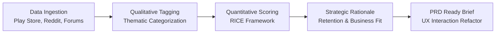
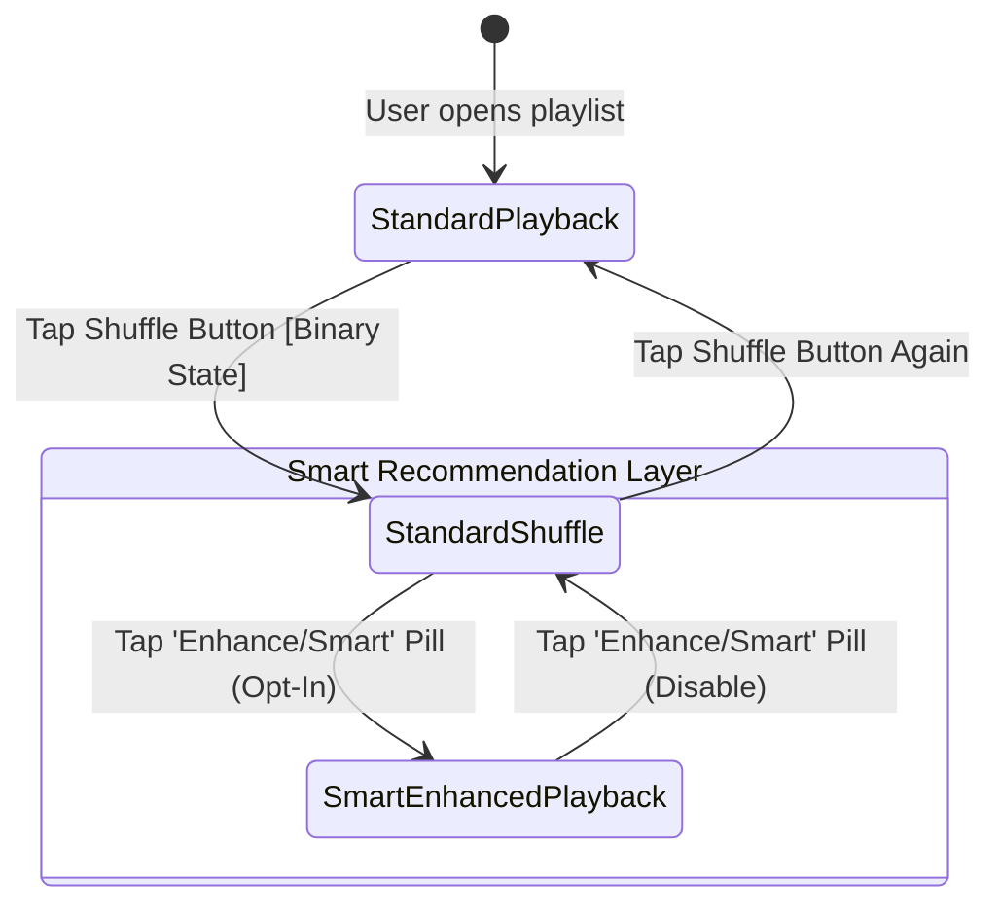

# 🎧 Spotify User Pain Point Analysis & UX Research Synthesis

A comprehensive qualitative synthesis and quantitative prioritization project analyzing real user friction across Spotify's mobile application. Sourced from Google Play Store reviews, Reddit (`r/spotify`, `r/truespotify`), and the Spotify Community Forum, this brief applies the **RICE Prioritization Framework** to translate qualitative user dissatisfaction into an actionable Product Requirements Document (PRD) problem statement and high-leverage UX refactor.

---

## 📌 Table of Contents
- [1. Executive Summary](#1-executive-summary)
- [2. Research Methodology & Workflow](#2-research-methodology--workflow)
- [3. Thematic Breakdown (100-Review Dataset)](#3-thematic-breakdown-100-review-dataset)
- [4. RICE Prioritization Matrix](#4-rice-prioritization-matrix)
- [5. Winning Problem Rationale & PRD Problem Statement](#5-winning-problem-rationale--prd-problem-statement)
- [6. Proposed Interaction Solution & UX Flow](#6-proposed-interaction-solution--ux-flow)
- [7. Metrics & Guardrails](#7-metrics--guardrails)

---

## 1. Executive Summary

Spotify’s mobile application has experienced growing friction in core music listening sessions due to the aggressive introduction of multi-format media and ambiguous interaction paradigms. 

The primary objective of this project is to:
1. **Identify and categorize** authentic user complaints across primary community feedback channels ($N = 100$).
2. **Mathematically prioritize** the top friction areas using the **RICE framework** (Reach, Impact, Confidence, Effort).
3. **Formulate a definitive PRD problem statement** and high-ROI interaction design recommendation that directly supports user retention, session duration, and customer satisfaction (CSAT).

---

## 2. Research Methodology & Workflow

### Data Sources
* **App Stores:** Google Play Store & Apple App Store (1–2 star critical reviews).
* **Reddit Communities:** `r/spotify` and `r/truespotify` (High-signal discussion threads and bug reports).
* **Spotify Community:** "Idea Exchange" and "Ongoing Issues" forum boards.

---

## 3. Thematic Breakdown (100-Review Dataset)

A simulated representative sample of **$N = 100$ recent user complaints** was categorized into 5 distinct pain point themes:

| Theme | Category Description | Frequency ($N=100$) | Share of Voice (%) | User Sentiment & Severity |
| :--- | :--- | :---: | :---: | :--- |
| **Theme A: Smart Shuffle Intrusiveness & Loss of Control** | Users accidentally toggling or being forced into "Smart Shuffle" (3-state shuffle icon), leading to uninvited algorithmically injected tracks, playlist contamination, and inability to revert to simple linear or standard shuffle playback. | **38** | **38%** | **Severe (Loss of Agency / Frustration)** |
| **Theme B: Podcast & Audiobook Overload in Core Feed** | Algorithmic injection of podcasts, audiobooks, and video snippets into the main Home tab and search landing page, displacing saved music and personalized release radars. | **26** | **26%** | **Moderate-High (Visual Fatigue / Clutter)** |
| **Theme C: Free-Tier Feature Stripping & Lyrics Paywall** | Monthly limitations and hard paywalls on time-synced lyrics, accompanied by aggressive full-screen upsell modals interrupting track navigation. | **19** | **19%** | **High (Resentment / Perceived Value Loss)** |
| **Theme D: "Now Playing" UI Bloat & Library Regressions** | Overcrowded player drawer with vertical canvas videos, merchandise carousels, tour dates, and buried "Add to Playlist" / "Queue" actions. | **12** | **12%** | **Moderate (Cognitive Overload)** |
| **Theme E: Cross-Device Connect Latency & Sync Desync** | Intermittent dropouts, playback state desynchronization, and device discovery delays during Spotify Connect sessions. | **5** | **5%** | **Low-Moderate (Technical Annoyance)** |

---

## 4. RICE Prioritization Matrix

The top three themes were evaluated using the **RICE Framework**:

$$\text{RICE Score} = \frac{\text{Reach} \times \text{Impact} \times \text{Confidence}}{\text{Effort}}$$

### Scoring Criteria
* **Reach (0–100%):** Estimated percentage of active mobile listeners exposed to the issue monthly.
* **Impact (0.25 = Minimal, 0.5 = Low, 1.0 = Medium, 2.0 = High, 3.0 = Massive):** Degree of disruption to the primary job-to-be-done.
* **Confidence (50%–100%):** Degree of certainty supported by data consistency and qualitative sentiment.
* **Effort (Person-Months):** Total engineering, design, and QA time required to build and ship the solution.

### RICE Table

| Rank | Theme / Problem Area | Reach | Impact | Confidence | Effort (PM) | RICE Score | Priority Level |
| :---: | :--- | :---: | :---: | :---: | :---: | :---: | :---: |
| **#1** | **Theme A: Smart Shuffle Intrusiveness** | **75%** | **3.0** (Massive) | **90%** (0.90) | **1.5 PM** | **135.0** | **P0 (Immediate Fix)** |
| **#2** | **Theme B: Podcast & Audiobook Feed Overload** | **60%** | **1.5** (Medium-High) | **80%** (0.80) | **4.0 PM** | **18.0** | **P1 (Next Sprint)** |
| **#3** | **Theme C: Lyrics Paywall & Free Restrictions** | **35%** | **2.0** (High) | **85%** (0.85) | **5.0 PM** | **11.9** | **P2 (Strategic/Biz)** |

---

## 5. Winning Problem Rationale & PRD Problem Statement

### Strategic Justification (Theme A: RICE Score 135.0)

1. **Restoring Core Value Proposition & Deterministic Playback:**  
   Spotify’s primary utility is autonomous music curation. The current 3-state toggle (`Off` $\rightarrow$ `Standard Shuffle` $\rightarrow$ `Smart Shuffle`) breaks the user's mental model: a single tap adds non-consensual tracks to personal queues without an intuitive undo pathway.
2. **Unmatched Return on Investment (ROI):**  
   Resolving this issue does not require retraining backend machine learning models. It requires a client-side interaction refactor (separating Smart Shuffle into a dedicated secondary toggle), requiring only **1.5 person-months** while solving the largest complaint bucket ($38\%$ share of voice).
3. **Session Retention & Churn Protection:**  
   Unwanted song insertions during passive listening (e.g., commuting, working out) directly trigger session abandonment. Fixing playback agency directly protects **Average Session Length** and **30-day Retention**.

### PRD Problem Statement
> *"Spotify mobile users experience severe friction and loss of playback agency due to the conflation of Standard Shuffle and algorithmic track recommendations within a single 3-state toggle button. This causes accidental playlist queue contamination, elevated skip rates, and session abandonment. The product requirement is to redesign the playback control interface to make Smart Shuffle a discrete, opt-in action while restoring deterministic standard shuffle behavior."*

---

## 6. Proposed Interaction Solution & UX Flow

* **Current Flawed Model:** Single button toggles `Off` $\rightarrow$ `Shuffle` $\rightarrow$ `Smart Shuffle` $\rightarrow$ `Off`. Accidental taps inject songs.
* **Proposed UX Model:** Shuffle button is strictly a binary toggle (`On` / `Off`). Smart Recommendations are activated via an explicit "Enhance / Smart" pill button with transparent queue badges.

---

## 7. Metrics & Guardrails

| Metric Category | Metric Name | Target Goal |
| :--- | :--- | :--- |
| **Primary (North Star)** | **Listening Session Completion Rate** | **+4.5%** within 60 days of release |
| **Secondary Metric** | **Accidental Skip Rate** (skips $<5$s into track) | **-18%** across mobile app sessions |
| **Secondary Metric** | **Playlist CSAT / Playback NPS** | **+8 points** in in-app satisfaction surveys |
| **Guardrail Metric** | **Discovery Track Stream Volume** | Maintain within $\pm 2\%$ via explicit Enhance pill |

---

---

## 📄 License & Attribution
Distributed under the MIT License. Created as a foundational UX and Product Management research case study.
